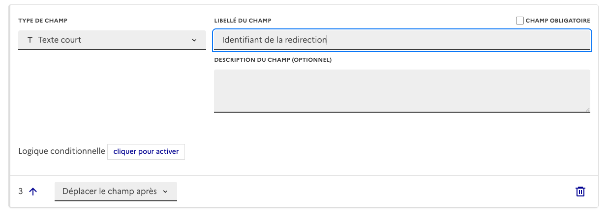
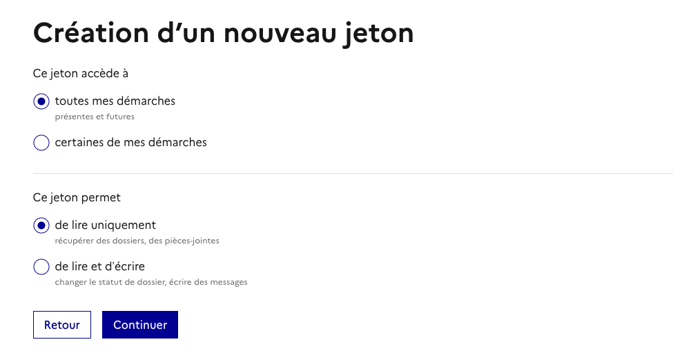
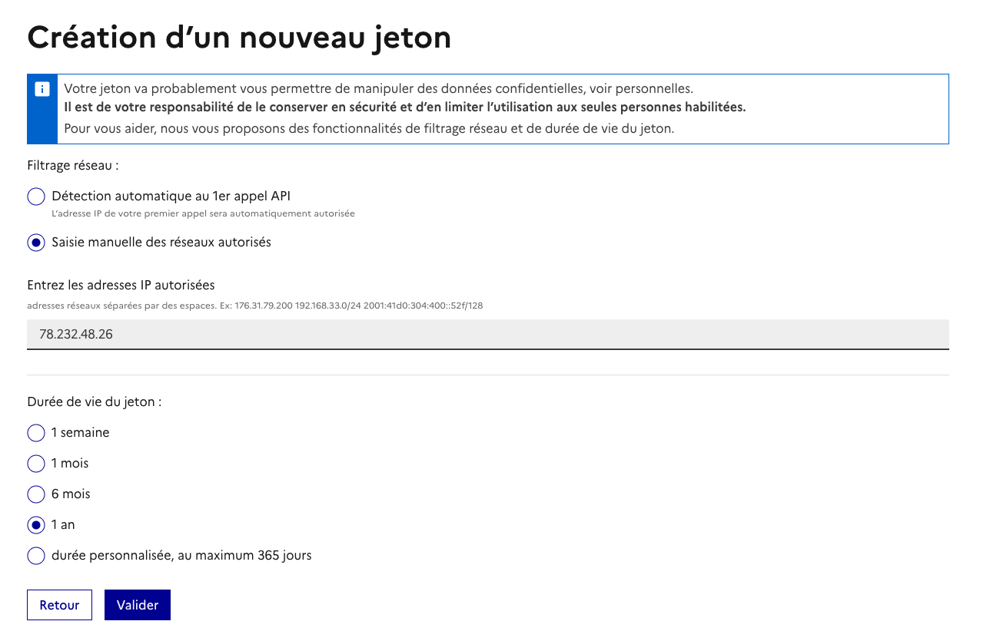
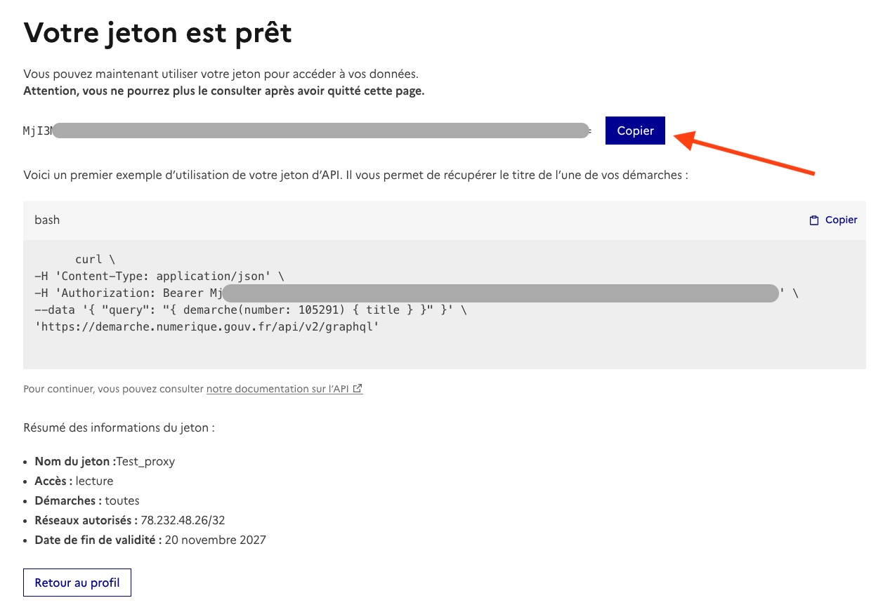

# Connecter vos démarches Démarche Numérique

Si vos candidatures passent par une démarche [Démarche Numérique](https://demarche.numerique.gouv.fr) (ex-Démarches Simplifiées), API Engagement lit les dossiers déposés pour les rattacher aux redirections de vos missions et comptabiliser les candidatures.

La connexion se fait en deux étapes : préparer chaque démarche, puis nous transmettre un jeton API en lecture.

## Étape 1 : préparer la démarche

Chaque démarche doit contenir une **annotation privée** de type **« Texte court »** intitulée **« Identifiant de la redirection »**. Ce champ est renseigné automatiquement lorsqu'un candidat arrive depuis une mission diffusée par l'API Engagement : il permet de rattacher le dossier déposé à cette redirection.

Pour l'ajouter :

1. Connectez-vous à Démarche Numérique avec un **compte administrateur** de la démarche.
2. Dans **« Mes démarches »**, ouvrez la démarche concernée.
3. Dans la rubrique **« Annotations privées »**, cliquez sur **« Modifier »**.
4. Cliquez sur **« Ajouter une annotation »**, choisissez le type **« Texte court »** et saisissez le libellé **« Identifiant de la redirection »**.
5. Si la démarche est déjà publiée, publiez les modifications pour qu'elles s'appliquent aux nouveaux dossiers.

<figure><figcaption>
Ajout du champ « Identifiant de la redirection »
</figcaption></figure>


Le libellé doit être exactement **« Identifiant de la redirection »**. Laissez le champ facultatif.


## Étape 2 : nous transmettre un jeton API

Créez un jeton API et transmettez-le-nous. Documentation officielle : [Jeton d'authentification](https://doc.demarches-simplifiees.fr/api-graphql/jeton-dauthentification).

1. Connectez-vous à Démarche Numérique avec un **compte administrateur** des démarches concernées.
2. Cliquez sur **« Voir mon profil »**, puis sur **« Créer et afficher un nouveau jeton »**.
3. Choisissez les démarches auxquelles le jeton accède. Nous recommandons **« certaines de mes démarches »** et de ne sélectionner que les démarches à connecter.
4. Choisissez **« de lire uniquement »** : API Engagement n'écrit rien dans vos dossiers. Cliquez sur **« Continuer »**.

<figure><figcaption>
Choix des démarches et accès en lecture seule
</figcaption></figure>

5. Filtrage réseau : choisissez **« Saisie manuelle des réseaux autorisés »** et saisissez l'adresse IP de sortie d'API Engagement : `78.232.48.26`. Cette restriction est obligatoire pour les jetons créés depuis le 1er juillet 2026.
6. Durée de vie du jeton : choisissez **« 1 an »** (durée maximale), puis cliquez sur **« Valider »**.

<figure><figcaption>
Filtrage réseau sur l'IP d'API Engagement et durée de vie
</figcaption></figure>

7. Cliquez sur **« Copier »** pour récupérer le jeton : **il n'est affiché qu'à sa création**.

<figure><figcaption>
Copie du jeton
</figcaption></figure>


Tous les appels d'API Engagement vers Démarche Numérique sortent par cette adresse IP fixe. Votre jeton n'est donc utilisable que depuis nos serveurs : même s'il fuitait, il ne fonctionnerait pas ailleurs.


Transmettez ensuite le jeton à l'équipe API Engagement par un canal sécurisé (pas en clair dans un e-mail ou un ticket partagé). Il est stocké chiffré et n'est jamais réaffiché.


Si le jeton expire ou est révoqué, les candidatures ne remontent plus : créez-en un nouveau et transmettez-le-nous.


Après réception du jeton, l'équipe API Engagement réalise une candidature test et vous confirme que le suivi fonctionne.
